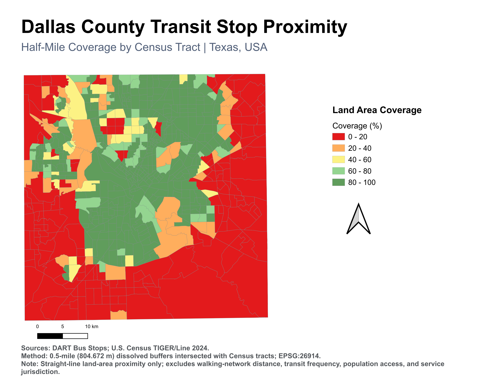
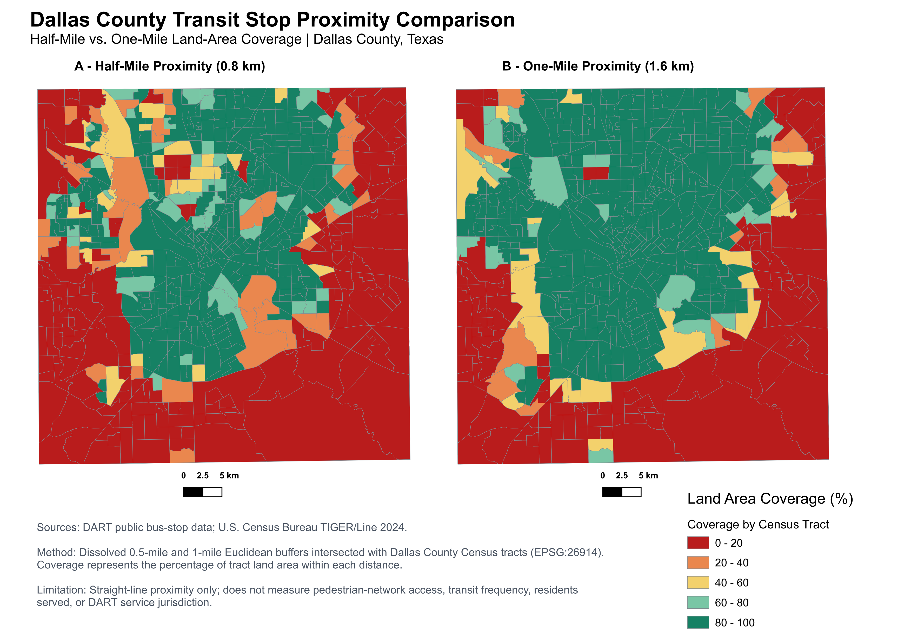
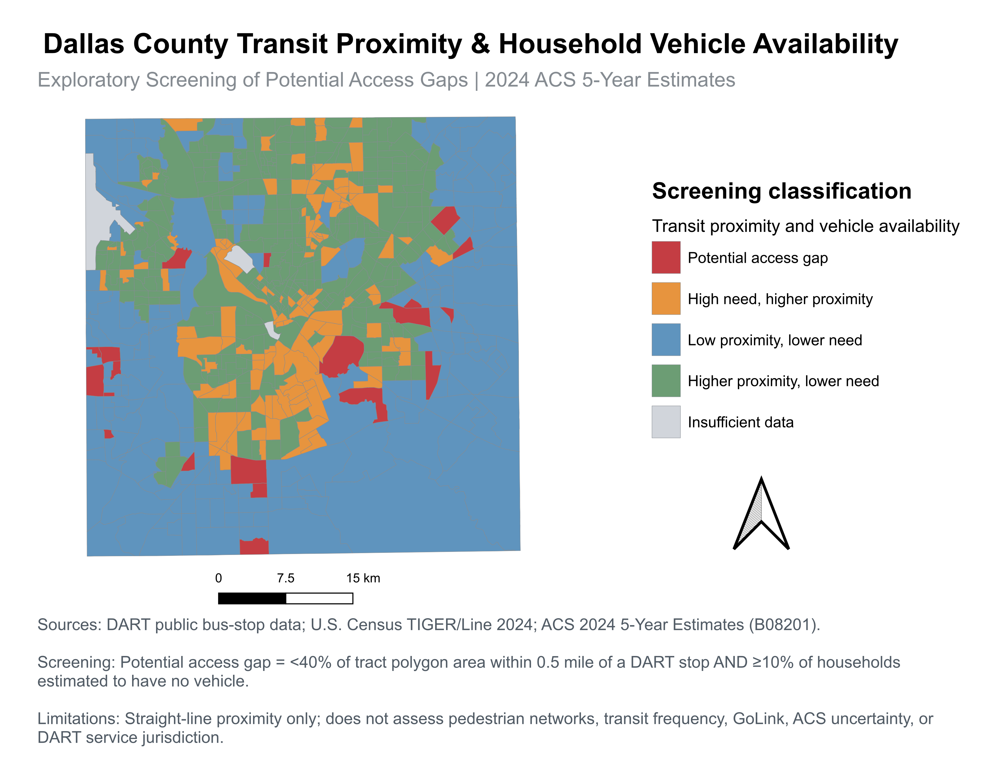
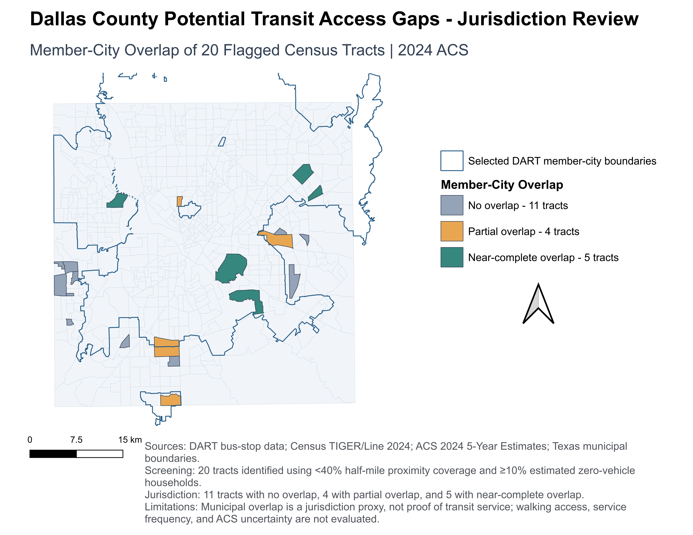

# Dallas Transit Accessibility & Vehicle Availability Analysis

### A Geospatial Study of DART Bus-Stop Proximity, Household Vehicle Availability, and Municipal Jurisdiction

**Tools:** QGIS | ArcGIS Online | ArcGIS StoryMaps | GeoPackage | U.S. Census ACS | Spatial Analysis

[View Interactive StoryMap](https://storymaps.arcgis.com/stories/c881ee773c4f4dc089b7b7860edf7684) | [Read Full Case Study](documentation/Dallas_Transit_StoryMap_Case_Study.pdf)

---

## Project Overview

How does geographic proximity to public transit vary across Dallas County, Texas, and where might households without vehicles face additional transportation challenges?

This project integrates **6,976 DART bus stops**, **645 Census tracts**, and **2024 ACS 5-Year household vehicle-availability estimates** to evaluate geographic proximity to transit infrastructure.

Using QGIS, I performed spatial buffering, polygon intersection, demographic data integration, comparative coverage analysis, and municipal-boundary overlays to identify potential transit access gaps.

The findings are exploratory and do not establish actual pedestrian accessibility or transit service deficiencies.

## Key Findings

| Metric | Result |
|---|---:|
| Census tracts analyzed | 645 |
| DART bus stops analyzed | 6,976 |
| Half-mile area-weighted coverage | **38.99%** |
| One-mile area-weighted coverage | **51.82%** |
| Increase in proximity coverage | **+12.83 percentage points** |
| Tracts meeting exploratory access-gap criteria | **20** |
| Estimated zero-vehicle households across flagged tracts | **4,033** |
| Flagged tracts with no selected member-city overlap | 11 |
| Flagged tracts with partial overlap | 4 |
| Flagged tracts with near-complete overlap | 5 |

Coverage percentages represent the area-weighted share of mapped Census tract polygons within each straight-line distance threshold, not the percentage of residents served.

## 1. Half-Mile Transit-Stop Proximity

Generated 0.5-mile (804.672 m) Euclidean buffers around DART bus stops and calculated the percentage of each Census tract polygon covered.

**Finding:** 38.99% of the total mapped tract-polygon area falls within half a mile of a mapped DART bus stop.

## 2. Half-Mile vs. One-Mile Comparison

Compared geographic coverage using consistent classification ranges and geographic scales.

Expanding the proximity threshold to one mile increased countywide area-weighted coverage to **51.82%**, a gain of **12.83 percentage points**.

Across 645 tracts, 335 had no reported coverage increase at the stored precision, while 68 gained at least 40 percentage points.

## 3. Household Vehicle Availability Screening

Integrated 2024 ACS 5-Year Table B08201 with Census tract polygons using 11-digit GEOIDs.

Calculated the percentage of households without an available vehicle and applied exploratory screening criteria:

- Half-mile tract-area coverage below 40%.
- Estimated zero-vehicle household share of at least 10%.

**Result:** 20 Census tracts met both conditions, containing an estimated 4,033 zero-vehicle households.

These households have not been individually located relative to transit stops.

## 4. DART Member-City Jurisdiction Review

Compared the 20 flagged tracts with selected DART member-city municipal boundaries.

Results:

- **11 tracts:** No municipal overlap.
- **4 tracts:** Partial municipal overlap.
- **5 tracts:** Near-complete municipal overlap.

This additional analysis helps distinguish potential DART-focused investigations from broader regional transportation concerns.

**Example:** Census Tract 181.10 had 100% overlap with selected member-city geography but only 29.89% half-mile bus-stop proximity coverage. ACS estimated 241 zero-vehicle households (MOE ±236).

Municipal overlap is a jurisdictional proxy, not proof of actual transit service availability.

## GIS Methodology

1. **Data preparation:** Reprojected spatial data into EPSG:26914 (NAD83 / UTM Zone 14N), prepared Census tract geometries, and standardized GEOIDs.
2. **Buffer analysis:** Created dissolved 0.5-mile and 1-mile Euclidean buffers around DART bus stops.
3. **Spatial overlay:** Intersected the buffers with Census tracts and calculated tract-level coverage percentages.
4. **Comparative analysis:** Calculated percentage-point gains and countywide area-weighted proximity coverage.
5. **Demographic integration:** Joined ACS household vehicle-availability estimates and calculated zero-vehicle household shares.
6. **Exploratory screening:** Classified tracts using transit proximity and vehicle-availability thresholds.
7. **Jurisdiction analysis:** Dissolved selected DART member-city boundaries and calculated their area overlap with flagged tracts.
8. **Quality assurance:** Checked coordinate systems, joins, tract counts, attribute calculations, coverage bounds, and classification totals.

## Data Sources

| Dataset | Provider |
|---|---|
| DART bus-stop locations | Dallas Area Rapid Transit, public GIS data |
| 2024 Census tract boundaries | U.S. Census Bureau, TIGER/Line |
| 2024 ACS 5-Year Estimates, B08201 | U.S. Census Bureau |
| Texas municipal boundaries | Texas Geographic Information Office |

### Source Links

- [DART Official Website](https://www.dart.org/)
- [U.S. Census TIGER/Line 2024](https://www.census.gov/geographies/mapping-files/time-series/geo/tiger-line-file.2024.html)
- [ACS 2024 Table B08201](https://data.census.gov/table/ACSDT5Y2024.B08201)
- [Texas Municipal Boundaries](https://feature.geographic.texas.gov/arcgis/rest/services/City_Boundaries/Texas_City_Boundaries/MapServer/0)

## Explore the Project in QGIS

This repository includes a portable QGIS project and five processed GeoPackage datasets.

### Requirements
- QGIS 3.x

### Getting Started
1. Select **Code → Download ZIP** and extract the repository.
2. Open `Dallas_Transit_Accessibility_Portfolio.qgz` in QGIS.
3. Explore the three layer groups: Transit Proximity, Vehicle Availability Screening, and DART Member-City Jurisdiction Review.
4. Open the attribute tables to inspect tract-level coverage, ACS screening categories, and municipal overlap results.

The project uses relative paths. Preserve the repository's folder structure when downloading or moving files.

### Reproducibility
The repository includes selected final analytical datasets and documented GIS methodology. It is not a fully automated raw-data-to-results processing pipeline.

## Limitations

- Euclidean buffers do not measure walking routes, pedestrian safety, or travel time.
- Census tract polygon coverage does not measure the share of residents with transit access.
- ACS estimates have sampling uncertainty; tract-level margins of error can be substantial.
- Bus-stop proximity excludes service frequency, operating hours, rail access, and on-demand transportation.
- Selected member-city polygons provide preliminary jurisdictional context, not authoritative service-availability boundaries.
- Data sources and administrative membership information may represent different points in time.

## Future Work

- Network-based pedestrian accessibility analysis.
- Population-weighted transit proximity measures.
- GTFS-based route frequency and travel-time analysis.
- More detailed analysis of ACS estimate uncertainty.
- Review of current DART service boundaries and GoLink coverage.
- Integration of employment locations and travel opportunities.

## Technical Skills

**GIS:** QGIS, ArcGIS Online, ArcGIS StoryMaps, EPSG:26914, buffer analysis, intersection, dissolve, thematic mapping, cartographic layouts.

**Data Processing:** GeoPackage, CSV, GEOID standardization, attribute joins, calculated fields, QA/QC.

**Analysis:** Area-weighted metrics, demographic screening, spatial comparisons, ACS margins of error, geographic interpretation.

## Full Project Story

Explore the published [ArcGIS StoryMap — Mapping Transit Accessibility in Dallas County](https://storymaps.arcgis.com/stories/c881ee773c4f4dc089b7b7860edf7684).

The StoryMap includes the four final GIS maps, methodology, findings, planning implications, and limitations.
